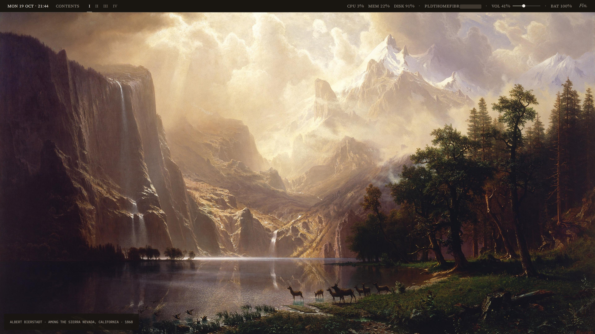
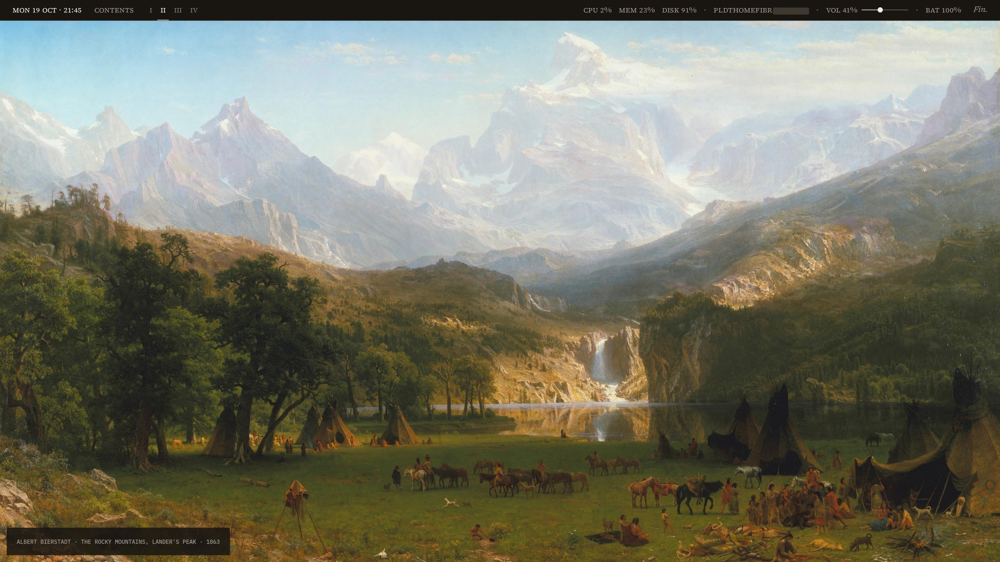
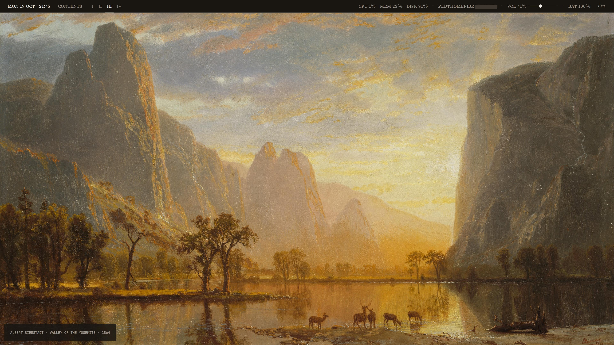
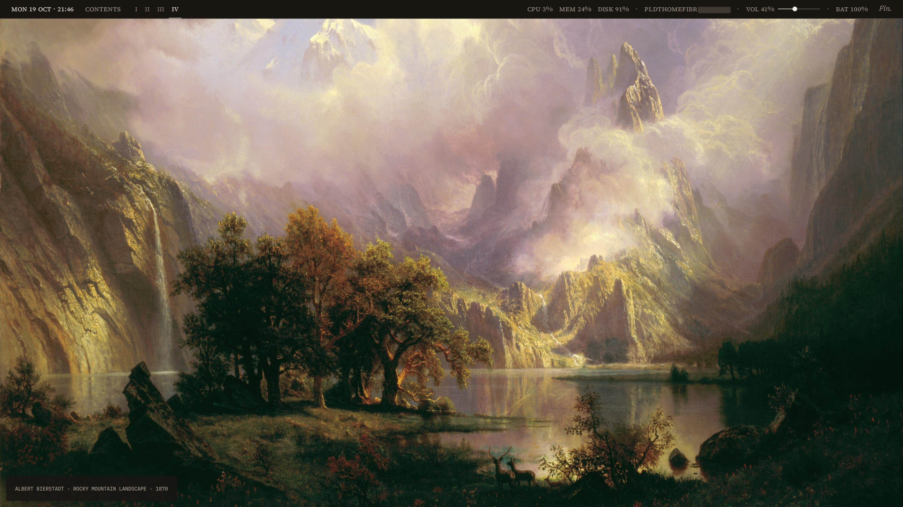
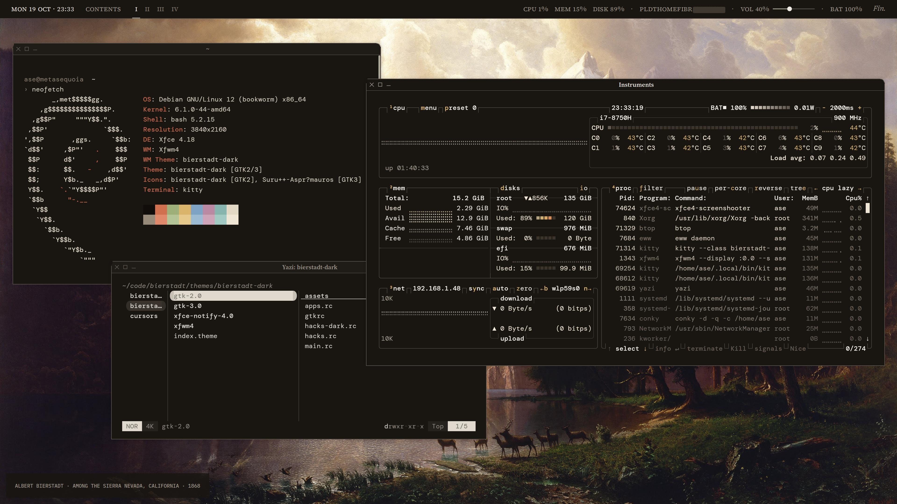
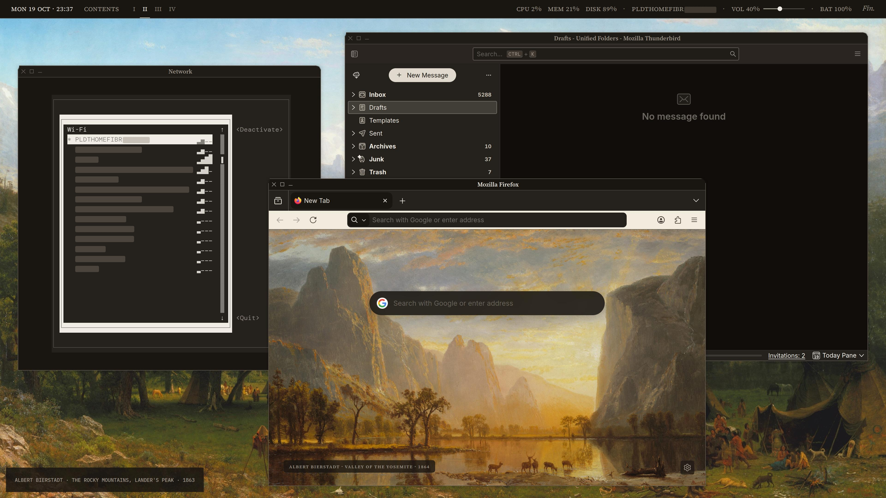
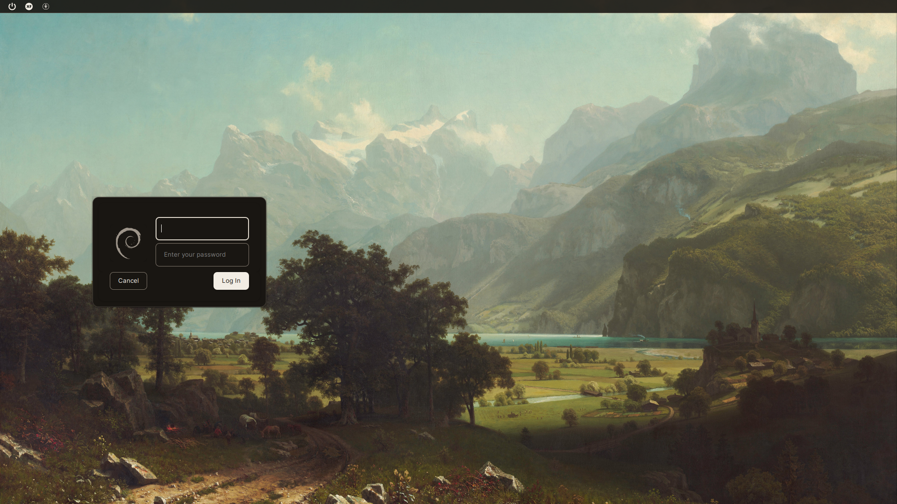

<div align="center">
    <h1>Bierstadt</h1>
    <p>Linux theme based on books and paintings by Albert Bierstadt</p>
</div>



## Screenshots

| | |
| --- | --- |
|  |  |
|  |  |
|  |  |



## Components

| | |
| --- | --- |
| distro | [Debian 12](https://www.debian.org) |
| de | [Xfce](https://www.xfce.org) |
| wm | xfwm4 |
| bar | [eww](https://github.com/elkowar/eww) |
| caption | [Conky](https://github.com/brndnmtthws/conky) |
| gtk / xfwm4 / notifyd | `bierstadt`, `bierstadt-dark` |
| icons | `bierstadt`, `bierstadt-dark` from [Suru++ Asprómauros](https://github.com/gusbemacbe/suru-plus-aspromauros) |
| cursor | [Bibata Modern](https://github.com/ful1e5/Bibata_Cursor), recoloured |
| terminal | [Kitty](https://sw.kovidgoyal.net/kitty/) |
| shell | [Bash](https://www.gnu.org/software/bash/) + [fzf](https://github.com/junegunn/fzf) |
| editor | [Neovim](https://neovim.io), [VSCodium](https://vscodium.com) |
| files | [Yazi](https://yazi-rs.github.io) |
| monitor | [btop](https://github.com/aristocratos/btop) |
| browser | [Firefox](https://www.mozilla.org/firefox/) |
| greeter | [lightdm-gtk-greeter](https://github.com/Xubuntu/lightdm-gtk-greeter) |
| splash | [Plymouth](https://www.freedesktop.org/wiki/Software/Plymouth/) |
| bootloader | [GRUB](https://www.gnu.org/software/grub/) |
| fonts | [Source Serif 4](https://fonts.google.com/specimen/Source+Serif+4), [Newsreader](https://fonts.google.com/specimen/Newsreader), [Inter](https://rsms.me/inter/), [DM Mono](https://fonts.google.com/specimen/DM+Mono), [IBM Plex Mono](https://fonts.google.com/specimen/IBM+Plex+Mono) |
| bg / dark | Bierstadt · *Among the Sierra Nevada, California* · 1868 |
| | Bierstadt · *The Rocky Mountains, Lander's Peak* · 1863 |
| | Bierstadt · *Valley of the Yosemite* · 1864 |
| | Bierstadt · *Rocky Mountain Landscape* · 1870 |
| bg / light | Monet · *Cliff Walk at Pourville* · 1882 |
| | Mønsted · *Summer Day by a Stream* · 1906 |
| | Polenov · *Moscow Courtyard* · 1878 |
| | Kuindzhi · *Birch Grove* · 1879 |
| bg / login | Bierstadt · *Lake Lucerne* · 1858 |

## Commands

```sh
sudo apt install xfce4 lightdm lightdm-gtk-greeter plymouth conky-all curl imagemagick python3-yaml python3-pil fonts-inter
```

```sh
git clone https://github.com/asemorales/bierstadt ~/code/bierstadt
cd ~/code/bierstadt
./install.sh
./setup.sh
```

```sh
echo 'include room.conf' >> ~/.config/kitty/kitty.conf
echo 'vim.cmd("colorscheme bierstadt")' >> ~/.config/nvim/init.lua
sed -i 's/^color_theme = .*/color_theme = "bierstadt-dark"/' ~/.config/btop/btop.conf
```

```sh
bierstadt-mode dark | light | toggle | status | data
bierstadt-bar start | stop | room | goto N | instruments | wifi
bierstadt-caption start | stop | restart | line1 | line2 | text
bierstadt-greeter
bierstadt-grub
bierstadt-plymouth
bierstadt-root '#191612'
```

```
~/.config/bierstadt/wall.yml
~/.config/eww/eww.yuck
~/.config/eww/_dark.scss
~/.config/eww/_light.scss
~/.config/kitty/bierstadt-dark.conf
~/.config/kitty/bierstadt-light.conf
```

## Shortcuts

| key | |
| --- | --- |
| `Super` `K` | kitty |
| `Super` `O` | obsidian |
